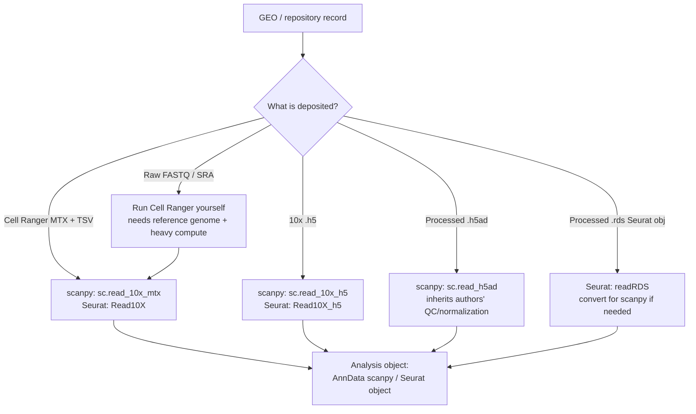

# Single-Cell RNA-seq with Scanpy — Dataset Selection

> Personal reference for learning scRNA-seq analysis in **scanpy** (with **Seurat** cross-references).
> Living document: sections are **updated in place** as understanding improves, never duplicated.
> Project dataset: **GSE253903** (human carotid atherosclerosis, scRNA-seq).

---

## Table of Contents

- [1. Dataset Selection & Evaluation](#1-dataset-selection--evaluation)
  - [1.1 Core concepts & terminology](#11-core-concepts--terminology)
  - [1.2 Where to find datasets](#12-where-to-find-datasets)
  - [1.3 What to look for — the 9-point pre-flight checklist](#13-what-to-look-for--the-9-point-pre-flight-checklist)
  - [1.4 Format determines your entry point (Seurat vs scanpy)](#14-format-determines-your-entry-point-seurat-vs-scanpy)
  - [1.5 Case study: GSE253903](#15-case-study-gse253903)
  - [1.6 Common pitfalls](#16-common-pitfalls)
  - [1.7 Best practices](#17-best-practices)
  - [1.8 Design decisions (this project)](#18-design-decisions-this-project)
  - [1.9 References](#19-references)

---

## 1. Dataset Selection & Evaluation

### 1.1 Core concepts & terminology

- **scRNA-seq** — measures gene expression in thousands–millions of *individual* cells, exposing heterogeneity that bulk RNA-seq averages away.
- **Droplet vs plate-based** — two assay families with different QC playbooks:
  - *Droplet* (10x Genomics): many cells, shallow depth per cell, **UMIs**, ambient RNA + empty droplets + doublets are the main enemies.
  - *Plate-based* (Smart-seq2): fewer cells, high/full-length depth per cell, often no UMIs.
- **UMI (Unique Molecular Identifier)** — random barcode tagging each original mRNA molecule so PCR duplicates can be collapsed → counts reflect molecules, not reads.
- **Count matrix** — genes × cells (or cells × genes) integer matrix; the fundamental input to all downstream analysis.
- **MTX / TSV (Cell Ranger output)** — sparse matrix triplet: `matrix.mtx` (values) + `barcodes.tsv` (cell IDs) + `features.tsv` (gene IDs). The standard raw-ish deliverable from 10x's Cell Ranger.
- **Batch effect** — systematic technical variation between samples/runs/donors that masquerades as biology; multiple samples ⇒ integration usually required.
- **Integration** — computationally aligning cells across batches so the same cell type from different samples co-clusters (e.g. Harmony, scVI, BBKNN).
- **Ground truth** — author-provided cell annotations you can validate your own pipeline against.
- **GEO Series / SuperSeries / SubSeries** — GEO groups samples into a **Series (GSE)**; a **SuperSeries** bundles multiple related SubSeries (e.g. an RNA SubSeries + a CITE-seq SubSeries).
- **GSM** — a single sample record inside a GEO Series.

### 1.2 Where to find datasets

| Repository | Best for | Notes |
|---|---|---|
| **GEO** (NCBI) | The default; most published scRNA-seq deposits here | Search by accession/keyword; check the *Supplementary file* row for the real matrices. |
| **SRA** (NCBI) | Raw FASTQ / reads | Reprocessing from scratch; human data often behind **dbGaP** controlled access. |
| **ArrayExpress / BioStudies** (EBI) | European deposits | GEO mirror + native submissions. |
| **CELLxGENE Discover** (CZI) | Ready-to-use, standardized `.h5ad` | Curated, already-QC'd; great for quick analysis, weaker for learning the full pipeline. |
| **Single Cell Portal** (Broad) | Curated studies with annotations + viewer | Good ground-truth availability. |
| **Human Cell Atlas Data Portal** | Reference atlases | Large, standardized. |
| **10x Genomics public datasets** | Clean demo data (e.g. PBMCs) | Ideal *sandboxes* for learning mechanics. |
| **Zenodo / figshare** | Author-hosted processed objects | Often where the final `.h5ad`/`.rds` actually lives. |

**Rule of thumb:** if the goal is *learning the pipeline*, prefer a source that gives you **raw-ish matrices + published annotations** (GEO). If the goal is *fast analysis*, prefer a curated `.h5ad` (CELLxGENE).

### 1.3 What to look for — the 9-point pre-flight checklist

Run this before committing to any dataset:

1. **Organism & tissue** → sets reference genome + the marker-gene vocabulary for annotation.
2. **Assay / platform** → droplet vs plate decides your entire QC strategy and whether UMIs exist.
3. **Data format = entry point** *(most important, most ignored)* → determines how much of the pipeline you own (see §1.4).
4. **Experimental design & sample count** → multiple samples/conditions ⇒ batch effects ⇒ integration needed; also tells you what biological contrast is available.
5. **Scale (cells × genes) & depth** → feasibility on your hardware + statistical power.
6. **Ground truth / validation** → is it published with annotations you can check against? For *learning*, this is the single most valuable property.
7. **Metadata / clinical labels** → confirm condition labels are actually retrievable and mappable to samples.
8. **Modality** → single (RNA) vs multimodal (CITE-seq/ATAC); confirm the modality you want is in *this* accession, not a sibling.
9. **Access / licensing** → open vs controlled (dbGaP). Processed matrices are usually open even when raw reads are not.

### 1.4 Format determines your entry point (Seurat vs scanpy)

What is deposited dictates your first line of code and how much preprocessing you inherit.

**Entry-point cheat sheet (same input files, different objects):**

| Deposited format | scanpy | Seurat |
|---|---|---|
| Cell Ranger dir (`matrix.mtx`, `barcodes.tsv`, `features.tsv`) | `sc.read_10x_mtx(path, var_names='gene_symbols')` | `Read10X(data.dir=path)` → `CreateSeuratObject()` |
| Non-standard file names | `anndata.read_mtx()` + manual `.obs`/`.var` | `ReadMtx(mtx=, cells=, features=)` |
| 10x HDF5 (`*.h5`) | `sc.read_10x_h5(path)` | `Read10X_h5(path)` |
| Processed AnnData (`.h5ad`) | `sc.read_h5ad(path)` | convert via `zellkonverter`/`sceasy` |
| Processed Seurat (`.rds`) | convert via `sceasy`/`SeuratDisk` | `readRDS(path)` |

**Key mental-model warning (do not skip):** the *input files are identical* across tools, but the resulting objects are **not** parallel. `sc.read_10x_mtx` returns an **`AnnData`** (everything mutates one object in place: `.X`, `.obs`, `.var`, `.layers`, `.obsm`, `.uns`). Seurat returns a **`Seurat` object** (assays + slots). Do **not** translate slot-by-slot between them; the storage philosophy differs. (Detailed in Section 2.)

### 1.5 Case study: GSE253903

Applying the checklist:

| Checklist item | GSE253903 |
|---|---|
| Organism / tissue | Human, carotid atherosclerotic plaque → expect macrophages, T/NK/B, mast, DC, endothelial, fibroblast, SMC, SMC-derived foam cells. |
| Assay / platform | 10x droplet, NovaSeq 6000 → UMI-based; standard droplet QC applies. |
| **Format / entry point** | Cell Ranger **MTX+TSV** in `GSE253903_RAW.tar` → `sc.read_10x_mtx()` per sample; **you own the whole pipeline** (good for learning). |
| Design / samples | **12 patients** (6 symptomatic / 6 asymptomatic) → 12 batches ⇒ **integration unavoidable**; biological contrast = symptomatic vs asymptomatic. |
| Scale / depth | Tens of thousands of cells; ~396 MB tar; laptop-feasible, but 12-sample integration stresses RAM/time. |
| Ground truth | Published, ~25 populations (PubMed 38385291) → you can validate your annotations. |
| Metadata | Symptomatic status available; must map each GSM → label. |
| Modality | **RNA only.** CITE-seq/ADT is in SuperSeries GSE253904, not here. |
| Access | Open download for processed matrices. |

**Verdict:** excellent for *learning* (raw matrices + published ground truth), but **not beginner-gentle** (12-sample integration front-loaded; plaque is dirty tissue: low yield, high mito, ambient RNA, foam-cell doublets).

### 1.6 Common pitfalls

- **Confusing SuperSeries with SubSeries** — assuming a modality is present because the *title* says so. Verify the accession you download actually contains it.
- **Ignoring deposited format** — grabbing a processed `.h5ad` and unknowingly inheriting someone else's QC/normalization choices, then "re-normalizing" already-normalized data.
- **GSM-prefixed file names break loaders** — GEO RAW tars name files like `GSM8029962_..._barcodes.tsv.gz`. Both `sc.read_10x_mtx()` and Seurat `Read10X()` expect **exactly** `barcodes.tsv.gz`, `features.tsv.gz`, `matrix.mtx.gz` inside a per-sample folder. Unhandled → load fails. (Fix in §1.10.)
- **Underestimating multi-sample datasets** — treating 12 samples like one; skipping integration produces clusters that are really just "which patient."
- **No ground truth** — choosing an unpublished/unannotated dataset while learning, so you can never tell a bug from biology.
- **Series Matrix ≠ single-cell** — the GEO "Series Matrix File" is often a bulk-style summary, not the cell-level counts.

### 1.7 Best practices

- **Read the GEO record fully** before downloading: Summary, Overall design, Platform, Samples, Supplementary file row, and any SuperSeries link.
- **Prefer raw matrices + published annotations** when the goal is learning.
- **Learn mechanics on a clean sandbox** (e.g. 10x `pbmc3k`, single sample) *before* fighting integration + dirty QC on the real dataset.
- **Record provenance**: accession, download date, file names, and the exact sample→condition mapping, in a project README.
- **Confirm the sample→metadata mapping exists and is retrievable** before investing in the dataset.

### 1.8 Design decisions (this project)

- **DD-1.** Use **GSE253903** as the real project dataset (accepted trade-off: harder, but published ground truth + full raw pipeline = strong learning value).
- **DD-2.** *(Recommended, pending)* Use 10x **`pbmc3k`** as a parallel sandbox to learn mechanics (QC → normalize → cluster → annotate) without integration noise, then transfer skills to GSE253903.
- **DD-3.** Toolchain = **scanpy** (Python/`AnnData`), with Seurat cross-references kept for orientation only — not as a 1:1 translation crutch.

### 1.9 References

- GSE253903 GEO record: `https://www.ncbi.nlm.nih.gov/geo/query/acc.cgi?acc=GSE253903`
- SuperSeries GSE253904 (includes CITE-seq): `https://www.ncbi.nlm.nih.gov/geo/query/acc.cgi?acc=GSE253904`
- Study publication: PubMed **38385291**
- scanpy docs: `https://scanpy.readthedocs.io`
- AnnData docs: `https://anndata.readthedocs.io`
